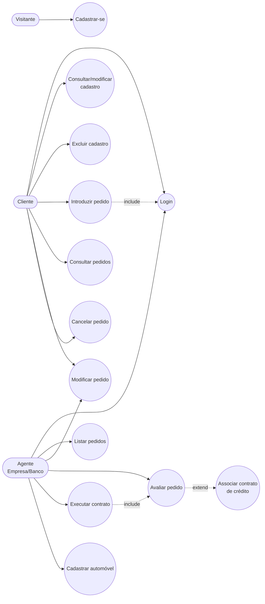
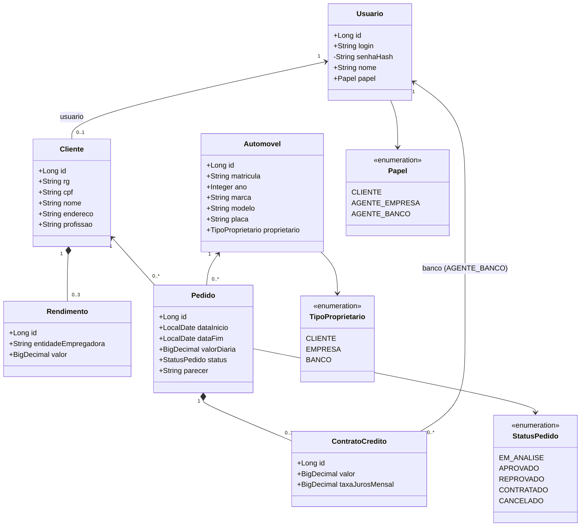
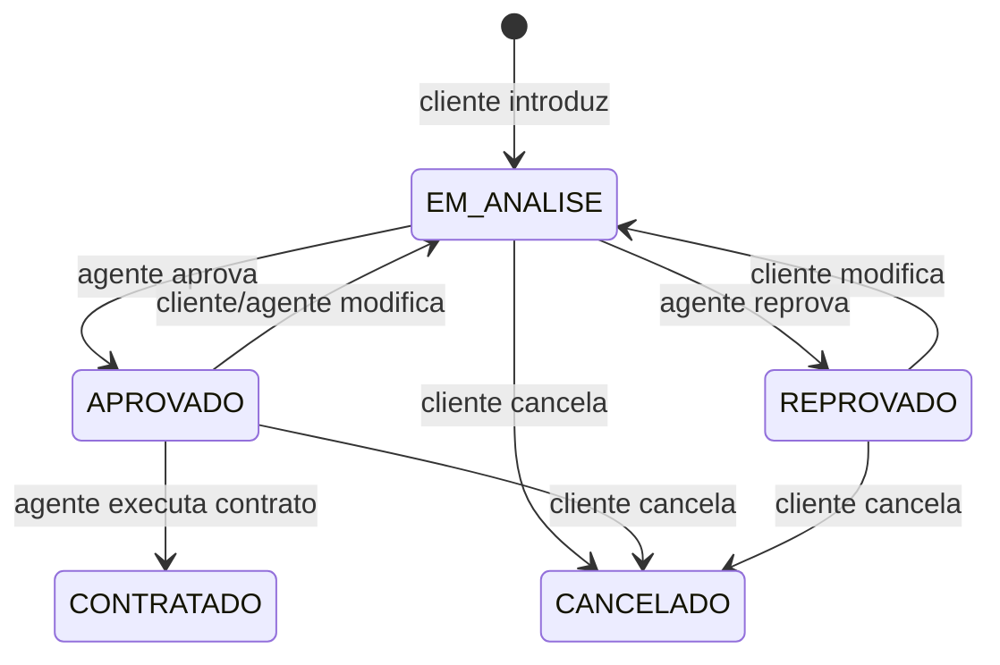
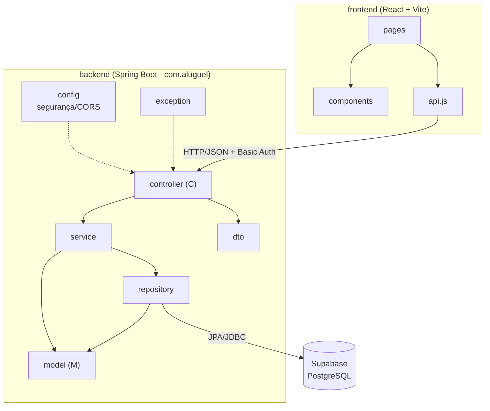

# Modelagem do Sistema de Aluguel de Carros

> Versão 1.0 — diagramas em Mermaid (renderizados automaticamente pelo GitHub).
> Ao alterar o código, atualize este arquivo e registre a mudança no histórico ao final.

## 1. Histórias do Usuário

| ID | Como… | Quero… | Para… | Critérios de aceite |
|----|-------|--------|-------|---------------------|
| US01 | visitante | me cadastrar como cliente (RG, CPF, nome, endereço, profissão, até 3 rendimentos) | usar o sistema | CPF com 11 dígitos e único; login único; senha ≥ 6 caracteres; máx. 3 rendimentos |
| US02 | agente (empresa/banco) | me cadastrar como agente | avaliar pedidos | login único |
| US03 | usuário cadastrado | fazer login com usuário e senha | acessar o sistema | sem login, nenhuma rota (exceto cadastro) é acessível; erro claro para credenciais inválidas |
| US04 | cliente | consultar e modificar meu cadastro | manter dados atualizados | CPF continua único |
| US05 | cliente | excluir meu cadastro | encerrar minha conta | bloqueado se houver pedidos |
| US06 | cliente | introduzir um pedido de aluguel (automóvel, período, diária, crédito opcional) | alugar um carro | pedido nasce `EM_ANALISE`; data final ≥ inicial |
| US07 | cliente | consultar o status dos meus pedidos | acompanhar a análise | vê apenas os próprios pedidos |
| US08 | cliente | modificar um pedido | corrigir dados | só se não estiver `CONTRATADO`/`CANCELADO`; volta a `EM_ANALISE` |
| US09 | cliente | cancelar um pedido | desistir do aluguel | só se não estiver `CONTRATADO` |
| US10 | agente | listar todos os pedidos com dados e rendimentos do cliente | analisar financeiramente | — |
| US11 | agente | aprovar ou reprovar um pedido com parecer | decidir sobre o aluguel | só pedidos `EM_ANALISE` |
| US12 | agente | executar o contrato de um pedido aprovado | formalizar o aluguel | só pedidos `APROVADO` → `CONTRATADO` |
| US13 | agente | cadastrar automóveis (matrícula, ano, marca, modelo, placa, propriedade) | disponibilizá-los | placa e matrícula únicas |
| US14 | banco | ser associado a pedidos como concedente de crédito | financiar o aluguel | contrato de crédito opcional por pedido |

## 2. Diagrama de Casos de Uso

## 3. Diagrama de Classes

### Ciclo de vida do pedido

## 4. Diagrama de Pacotes (Visão Lógica)

Arquitetura MVC no back-end; o front-end React atua como camada de visão que consome a API REST.

Subsistemas citados no enunciado: **gestão de pedidos e contratos** (`controller/service/repository/model` do back-end) e **construção dinâmica das páginas web** (front-end React, que renderiza as telas a partir dos dados da API).

## 5. Histórico de versões

| Versão | Mudança |
|--------|---------|
| 1.0 | Modelos iniciais; código implementado com `Pedido` possuindo `ContratoCredito` opcional e `Usuario` unificando clientes e agentes (login), com `Cliente` como perfil do usuário com papel `CLIENTE`. |
